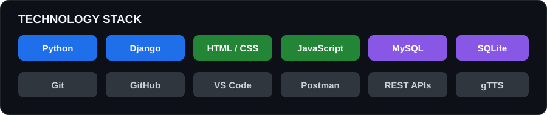
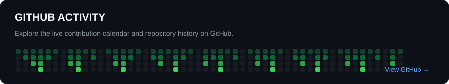

# SIRIKI SAI DHANUSH

### Python & Django Developer · Junior Developer

Building practical web applications, backend systems, and AI-powered tools.

<a href="https://dhanush7331.github.io/Portfolio/">Portfolio</a> · <a href="https://www.linkedin.com/in/siriki-sai-dhanush-404b5324a/">LinkedIn</a> · <a href="mailto:dhanushsirikisai@gmail.com">Email</a>

---

## 01 / PROFILE

<table>
<tr>
<td width="62%" valign="top">

I'm a **Junior Developer at Expand Software Solutions** with a postgraduate background in Information Technology. I enjoy developing useful web applications, building Python-based backend systems, and exploring AI-powered software.

- Currently working with web development and backend technologies
- Focused on Python, Django, SQL, and practical application development
- Exploring Generative AI and Machine Learning
- Based in Visakhapatnam, Andhra Pradesh, India

</td>
<td width="38%" valign="top">

**CURRENT ROLE**

Junior Developer  
Expand Software Solutions

**PRIMARY FOCUS**

Python · Django · Backend

**INTERESTS**

AI/ML · Web Applications · APIs

</td>
</tr>
</table>

## 02 / TECHNOLOGY STACK

| Area | Technologies |
|:--|:--|
| **Programming** | Python, JavaScript |
| **Backend** | Django, REST APIs |
| **Frontend** | HTML, CSS, Responsive Design |
| **Database** | SQL, SQLite, MySQL |
| **Tools** | Git, GitHub, VS Code, Postman |

## 03 / SELECTED PROJECTS

<table>
<tr>
<td width="50%" valign="top">

### FRIDAY AI
**Intelligent Voice Assistant**

A Django-based assistant combining conversational AI, voice interaction, and tool-based capabilities.

- AI-powered conversational responses
- Voice input and text-to-speech
- Tool integration for supported tasks
- Session-based conversation handling

**Stack:** Python · Django · LLM APIs · JavaScript · gTTS

</td>
<td width="50%" valign="top">

### Django ATM Banking System
**Banking Workflow Application**

A web application simulating common ATM and banking workflows.

- Account and customer management
- OTP-based ATM PIN generation by email
- Balance enquiry, deposits, withdrawals
- Fund transfers and Google reCAPTCHA

**Stack:** Python · Django · SQLite · SMTP

[View repository →](https://github.com/DHANUSH7331/Django-ATM-Banking-System)

</td>
</tr>
<tr>
<td width="50%" valign="top">

### Metro Ticket Booking
**QR-Based Ticketing Application**

A Django application for booking metro tickets and validating generated QR codes.

- User registration and authentication
- Source and destination selection
- QR ticket generation and email delivery
- QR scanning and ticket verification

**Stack:** Python · Django · SQLite · qrcode · Pillow

[View repository →](https://github.com/DHANUSH7331/Metro-Project)

</td>
<td width="50%" valign="top">

### Finance Dashboard
**Financial Data Interface**

A dashboard project focused on presenting financial information through a web interface.

[View repository →](https://github.com/DHANUSH7331/Finance-Dashboard-UI)

</td>
</tr>
</table>

## 04 / GITHUB ANALYTICS

## 05 / CONTRIBUTION SNAKE

The snake animation is generated automatically from my GitHub contribution history.

## 06 / EXPERIENCE & EDUCATION

| Category | Details |
|:--|:--|
| **Experience** | Junior Developer — Expand Software Solutions |
| **Postgraduate** | Information Technology — Andhra University College of Engineering |
| **Bachelor's** | B.Sc. Computer Science — Mrs A.V.N. College |
| **Professional Training** | Python Full Stack Development — QSpiders, Hyderabad (JNTU) |

## 07 / EXPLORE

<a href="https://github.com/DHANUSH7331?tab=repositories">All repositories</a> · <a href="https://dhanush7331.github.io/Portfolio/">My portfolio</a>

### Let's build something useful.

[GitHub](https://github.com/DHANUSH7331) · [LinkedIn](https://www.linkedin.com/in/siriki-sai-dhanush-404b5324a/) · [Email](mailto:dhanushsirikisai@gmail.com)

Always learning. Always building. Improving one project at a time.

